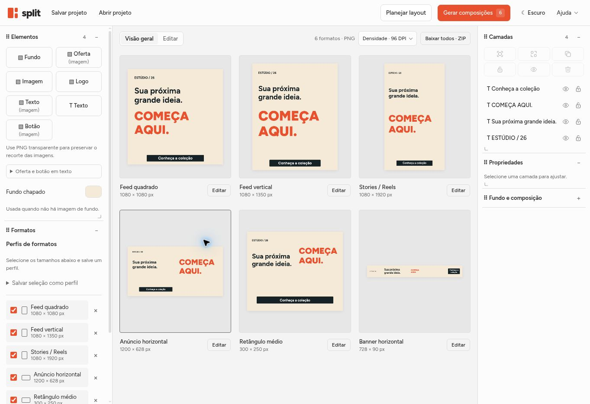

# Split

Editor web para transformar imagens, textos, logos, ofertas e botões em peças publicitárias de vários formatos.




## Acessar o app

[**Abrir Split no GitHub Pages**](https://keve00.github.io/split/)

## Executar localmente

O app é estático. Com **Node.js 22+**:

```sh
git clone https://github.com/Keve00/split.git
cd split
npm ci
npm start
```

`npm start` gera a `dist/` e abre http://127.0.0.1:8001. A `dist/` publicada
também funciona sem Node, por exemplo com `python -m http.server 8000 --directory dist`.

## Desenvolver

Edite apenas os arquivos de `src/`. A `dist/` é gerada a partir deles e fica
no repositório para o GitHub Pages:

```sh
npm run build        # gera a dist/ (remove espaços de JS e CSS, sem renomear nada)
npm run format       # formata src/ com Prettier
npm test             # testes de lógica sobre a dist/
```

Faça commit de `src/` e `dist/` juntos. A CI recusa um pull request em que a
`dist/` não corresponda à `src/` ou em que a `src/` não esteja formatada.

Os vídeos MP4 são gerados no próprio navegador (WebCodecs + Mediabunny), sem
servidor, chave de API ou LLM. Use Chrome ou Edge atualizado.

## Como usar

1. Adicione um fundo ou escolha uma cor chapada. Carregue as imagens de logo, texto, oferta e botão ou escreva os textos no editor.
2. Selecione formatos de saída, organizados em grupos como **Ads Meta** e **Banners para sites**. Marque um grupo inteiro de uma vez, adicione tamanhos sugeridos por canal (Meta, banners IAB, Google Ads, LinkedIn) ou personalizados, mova tamanhos entre grupos e salve seleções em perfis.
3. Clique em **Gerar composições** e ajuste os diagramas de posição para peças horizontais, superhorizontais, verticais e superverticais.
4. Edite cada peça: mova, redimensione proporcionalmente, gire, agrupe, alinhe, oculte e bloqueie camadas. Use Ctrl+Z para desfazer.
5. Siga a trilha de etapas acima das peças: ela mostra o que falta e leva ao painel certo. Peças com texto menor que 10 px, elementos fora da peça ou sobreposições recebem um alerta no card e no editor.
6. Ajuste o fundo, o foco e seu zoom. Exporte um PNG, um grupo ou todos os formatos em ZIP, com uma pasta por grupo.
7. Abra **Vídeos** para animar as camadas e baixar um MP4 por formato. Detalhes em [docs/VIDEO-STUDIO.md](docs/VIDEO-STUDIO.md).
8. Salve um arquivo `.split` para guardar imagens, formatos, diagramas e ajustes da campanha.

A geração de layouts e as adaptações de fundo acontecem no navegador, com algoritmos locais e OpenCV. Não utilizam LLMs ou modelos de geração de imagens.

No celular, o Split abre em modo de revisão: mostra as peças e baixa cada PNG. **Editar mesmo assim** libera o editor completo até fechar a aba.

## Dados e exportação

- Perfis, preferências e recuperação automática são locais ao navegador. O repositório não armazena campanhas nem imagens enviadas pelos usuários.
- O MP4 é codificado no navegador; as imagens não são enviadas a nenhum servidor.
- O arquivo `.split` contém os dados e as imagens necessários para reabrir a campanha em outro navegador.
- O PNG mantém exatamente as dimensões escolhidas em pixels. O controle de DPI grava a densidade de impressão e não aumenta a quantidade de pixels.
- Elementos fora da peça são recortados na exportação.

## Atalhos

- Ctrl + rolagem sobre o canvas: zoom da visualização.
- Espaço + arraste: navegar no canvas.
- Shift + clique: selecionar várias camadas.
- Alt + redimensionamento: redimensionar pelo centro.
- Ctrl+Z / Ctrl+Shift+Z: desfazer / refazer.

## Estrutura

O código-fonte está em `src/` e a versão publicada, gerada por `scripts/build.mjs`, em `dist/`. Servidores de apoio ficam em `server/` e os testes em `tests/` (`npm test`):

- `index.html`, `styles.css`, `workspace.css`: interface e temas.
- `app.js`, `editing.js`, `rotation.js`, `alignment.js`: canvas e edição.
- `layout.js`, `blueprint.js`, `adaptation.js`: composição e planejamento.
- `background.js`, `synthesis.js`, `feather.js`: adaptação e suavização do fundo.
- `project-codec.js`, `projects.js`, `format-profiles.js`, `format-groups.js`: projetos, perfis e grupos de formatos.
- `output-density.js`: densidade DPI dos PNGs.
- `video-studio.js`, `video-composition.js`, `video-animation.js`: autoria, prévia e contrato de vídeo.
- `video-browser-render.js`: codificação do MP4 no navegador.
- `interface.js`, `flow.js`: estado do botão Gerar, trilha de etapas, alertas de legibilidade e modo de revisão no celular.
- `server/static-server.cjs`: servidor de desenvolvimento (`npm start`).
- `server/video-server.cjs`: servidor opcional para renderizar o projeto Hyperframes exportado (`npm run hyperframes-server`; requer FFmpeg). A interface não depende dele.
- `fonts/` e `vendor/`: fontes Figtree e OpenCV, com suas licenças.

## Hospedagem estática

Publique o conteúdo de `dist/` em qualquer hospedagem estática.

O GitHub Pages já está ativo em https://keve00.github.io/split/. O workflow `.github/workflows/pages.yml` confere formatação, build e testes em cada pull request e, quando o app muda na branch `main`, testa e publica `dist/`. Na publicação, `?v=dev` nos arquivos do `index.html` vira o hash do commit, para os navegadores não usarem versões antigas em cache. Também é possível iniciar uma publicação manual pela aba Actions.

## Recursos de terceiros

- Figtree: `src/fonts/OFL.txt`.
- OpenCV: `src/vendor/OpenCV-LICENSE.txt`.

Versão inicial deste repositório: código publicado no Split em 8 de outubro de 2026.
